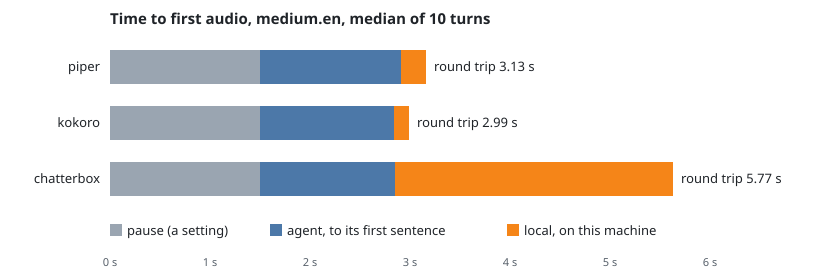

# Latency by speech engine

Measured 20 October 2026 on the RTX 5070 (12 GB), with `sidetone.service`
stopped. `scripts/latency-bench.ts` makes every number here. The records
and the fake-phone output stay in `~/.sidetone/bench/2026-10-20/`, and
`bun scripts/latency-bench.ts --report ~/.sidetone/bench/2026-10-20` prints
the table again.

## Result

| Question | Answer |
|---|---|
| Time to first audio, kokoro and medium.en | **3.0 s** at the median and 3.1 s at p95, at the phone. 1.5 s of it is the end-of-turn pause, 1.3 s is the agent and 0.15 s is the local speech |
| The local share | **0.15 s** with kokoro, 0.25 s with piper, 2.8 s with chatterbox, at the median |
| What the cloned voice costs | chatterbox adds about 2.6 s to the round trip against kokoro. It is the live voice, so this is the largest share the bridge owns |
| What the speech-to-text model costs | nothing on the round trip. Transcription starts at 400 ms of quiet, inside the 1.5 s pause, and the bridge waited for it 1 ms at most on all 151 turns. The choice of model sets accuracy and GPU memory ([whisper-scores.md](whisper-scores.md)), not latency |
| The largest share | the pause, 1.5 s, a setting. Then the agent, 1.3 to 1.9 s to its first sentence on these prompts |
| distil-medium.en | not usable: the bridge heard 3, 4 and 7 of 10 lines. The vocabulary prompt makes it write nothing, as whisper-scores.md found |
| The phone against the bridge | the same to within 0.1 s at the median on 14 of 15 pairs. The phone is on loopback, so this is not the network of the car |
| How sure | 10 turns a pair, so p95 is the slowest turn or the one before it. The prompts are short and need no tool; real turns take the agent longer (2.9 s at the median in [design.md](design.md#latency)) |

## Every pair

The agent column runs from the text going in to the first whole sentence.
Local is transcription waited for plus the first sentence to sound. The
medians do not add up to the round trip, but the parts of each turn do.

| STT | TTS | turns | local p50 | local p95 | agent p50 | agent p95 | pause | round trip p50 | round trip p95 | phone p50 | phone p95 |
|---|---|---|---|---|---|---|---|---|---|---|---|
| tiny.en | piper | 10/10 | 0.23 | 0.32 | 1.35 | 2.86 | 1.50 | 3.17 | 4.56 | 3.10 | 4.40 |
| base.en | piper | 10/10 | 0.25 | 0.48 | 1.35 | 2.76 | 1.50 | 3.10 | 4.42 | 3.20 | 4.40 |
| small.en | piper | 10/10 | 0.23 | 0.35 | 1.34 | 1.82 | 1.50 | 3.04 | 3.55 | 3.00 | 3.60 |
| medium.en | piper | 10/10 | 0.25 | 0.39 | 1.41 | 1.80 | 1.50 | 3.13 | 3.48 | 3.20 | 3.50 |
| distil-medium.en | piper | 3/10 | 0.16 | 0.17 | 1.47 | 1.47 | 1.50 | 3.11 | 3.14 | 3.20 | 3.60 |
| tiny.en | kokoro | 10/10 | 0.17 | 0.19 | 1.76 | 2.06 | 1.50 | 3.46 | 3.72 | 3.50 | 3.70 |
| base.en | kokoro | 10/10 | 0.17 | 0.23 | 1.40 | 6.73 | 1.50 | 3.07 | 8.43 | 3.10 | 8.40 |
| small.en | kokoro | 10/10 | 0.14 | 0.21 | 1.87 | 2.56 | 1.50 | 3.49 | 4.23 | 3.50 | 4.30 |
| medium.en | kokoro | 10/10 | 0.15 | 0.25 | 1.34 | 1.37 | 1.50 | 2.99 | 3.09 | 3.00 | 3.10 |
| distil-medium.en | kokoro | 4/10 | 0.14 | 0.21 | 1.76 | 1.91 | 1.50 | 3.41 | 3.62 | 3.40 | 4.80 |
| tiny.en | chatterbox | 10/10 | 2.19 | 3.55 | 1.30 | 2.83 | 1.50 | 5.30 | 6.35 | 5.30 | 6.30 |
| base.en | chatterbox | 10/10 | 2.40 | 3.61 | 1.32 | 1.59 | 1.50 | 5.26 | 6.43 | 5.20 | 6.50 |
| small.en | chatterbox | 10/10 | 2.31 | 3.75 | 1.30 | 2.29 | 1.50 | 5.49 | 6.48 | 5.50 | 6.50 |
| medium.en | chatterbox | 10/10 | 2.78 | 4.48 | 1.35 | 1.99 | 1.50 | 5.77 | 7.14 | 4.80 | 7.10 |
| distil-medium.en | chatterbox | 7/10 | 2.80 | 4.21 | 1.55 | 2.01 | 1.50 | 5.85 | 7.13 | 5.80 | 7.10 |

The phone median of medium.en and chatterbox, 4.8 s against 5.8 s at the
bridge, is not explained.

## How it was run

| Step | What |
|---|---|
| The phone | `scripts/fake-phone.ts`: it speaks each prompt as audio into a room of its own bridge and times the first audio back from the end of the prompt |
| The prompts | one warm-up line, not counted, then 10 short questions that need no tool (`PROMPTS` in the script) |
| The agent | Claude Code with `--model sonnet`, the live setting. About $1 a pair |
| The settings | the live config, with the engine pair, a record file of its own, and the sound on |
| Not measured | GPU memory: fake-phone loads its own copy of the same engines. The network of the car |
